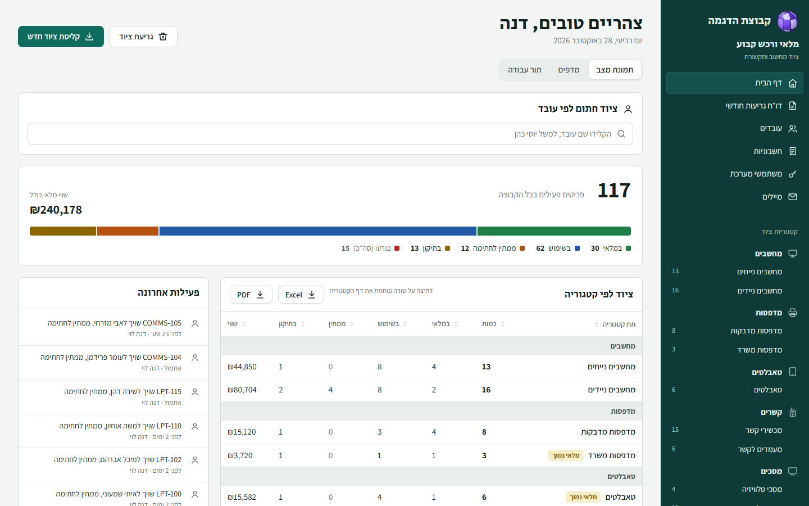
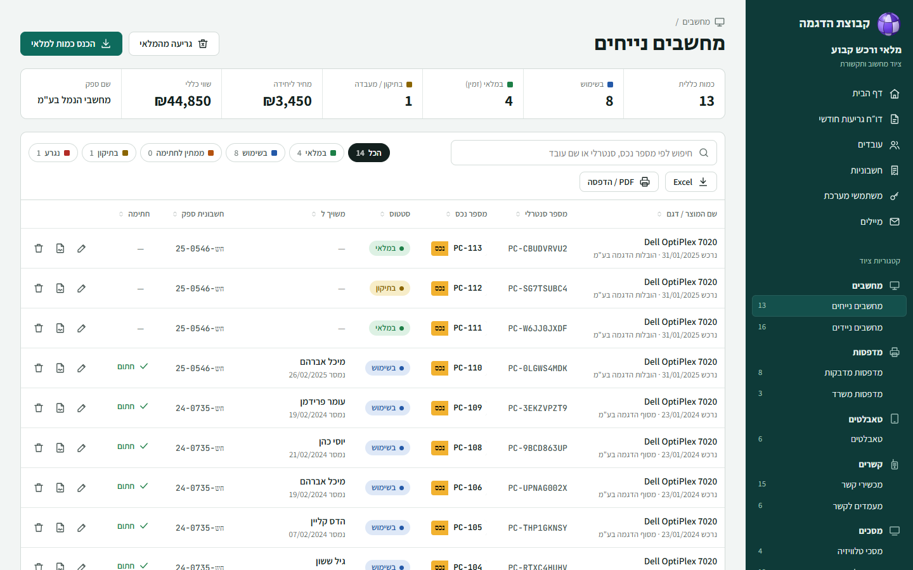
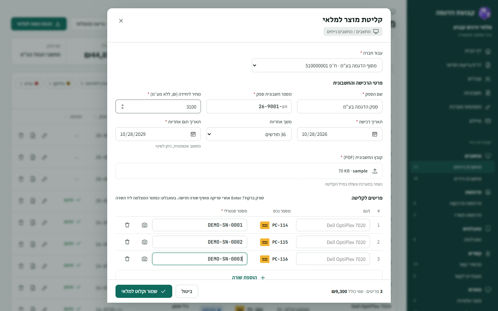
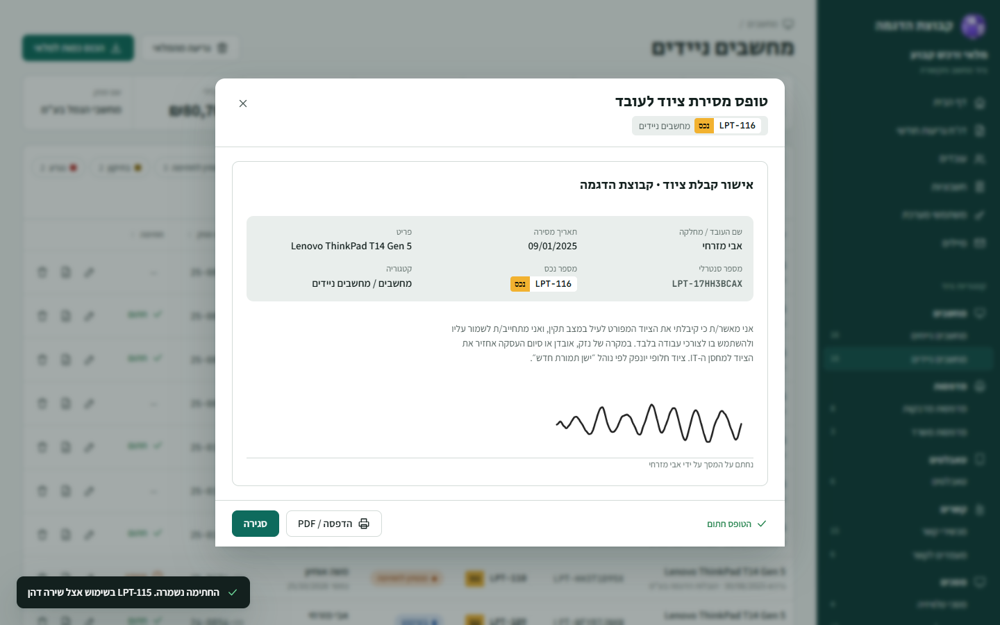
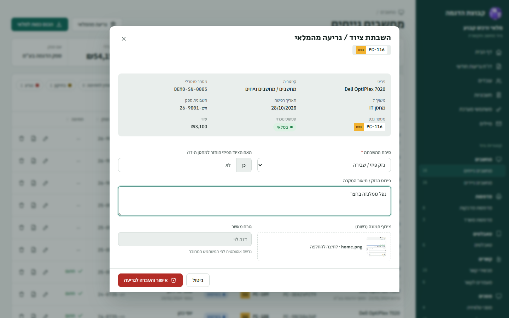
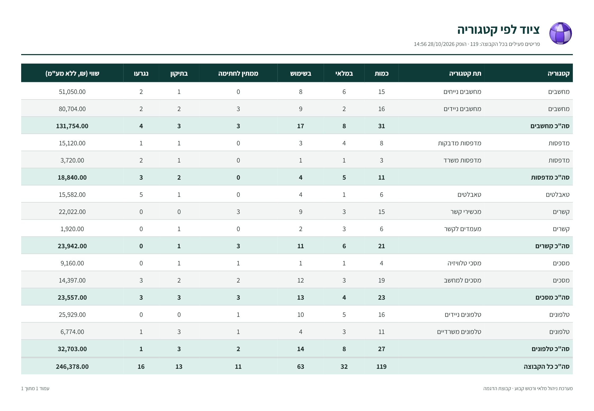

# Inventory: fixed-asset tracking for IT and communications equipment

A system for the equipment a company hands to its people: computers, label printers, tablets, radios,
screens and phones. Equipment is received against an invoice, numbered, handed to an employee who
signs for it on screen, sent to repair, and written off, with a monthly write-off report for
accounting. Hebrew and right-to-left.

**[Live demo →](https://MrCuteFace.github.io/inventory/)**: on the login screen, sign in as the
admin (דנה לוי) or a regular user (אלי מור) with one click.

**In daily production use** at a logistics company. This repository is a public demo of the front
end: the production ASP.NET Core API is not included. Instead, `web/src/mock/` runs the same API in
the browser, ported from the server's controllers, on invented employees, purchases and companies,
under an invented brand.



## Try this in the demo

1. **Receive equipment.** Open any category and click **הכנס כמות למלאי**. Pick a company, enter a
   supplier, invoice number and price, attach any PDF as the invoice, and scan or type a serial per
   row (Enter adds the next row). Asset numbers are allocated in sequence when you save.
2. **Hand it over.** On an item marked **ממתין** (awaiting signature), draw a signature on the pad.
   The item moves to **בשימוש**, and the signed handover form can be reopened and printed.
3. **Write something off.** Pick a reason, say whether the device came back to the IT store, and
   attach a photo. It appears on the monthly write-off report, which exports to Excel.
4. **Export.** Home → *ציוד לפי קטגוריה* → **Excel** or **PDF**. Category pages export their table
   for stock counts.
5. **As the admin**, open **חשבוניות** to view or replace invoice files, **משתמשי מערכת** to add a
   user (they get a temporary password and must change it), and **עובדים** → *ייבוא אלפון מאקסל*
   to preview an employee-list import before applying it.
6. Sign out and in as **אלי מור**: the admin pages are gone, and the API refuses them too.

Changes are kept for the browser tab (reload keeps them); a new tab starts from the seed data.

## What's interesting in it

**Status is derived, never stored.** An item's state is only *active / repair / written off*.
"In stock", "in use" and "awaiting signature" come from its open assignment: no open assignment
means in stock; open and unsigned means awaiting signature; signed means in use. There is no
status column to fall out of step with the handover history.

**Asset numbers can't collide.** Each sub-category keeps its next number, and intake allocates a
whole batch inside a transaction that locks that row, so two people receiving at once never get
the same number. The intake form shows the numbers it expects and says they're final only on save.

**Signatures on screen, as evidence.** The handover form is the employee's declaration plus their
drawn signature, stored with the assignment and reprintable. Reassigning an item closes the old
assignment rather than overwriting it, so every item keeps a full chain of who held it and when.

**Write-offs that accounting can use.** Each write-off records the reason (from a closed list), the
approver, whether the device came back, an optional damage photo and who last held it. The monthly
report totals the purchase value written off and flags devices missing from stock.

**Reports that look like the app.** Excel exports share one layout (title, subtitle, coloured
header row, stripes, totals, frozen header, landscape print setup), right-to-left. In this demo they
are generated in the browser with ExcelJS; the PDF is rendered from HTML so Hebrew text is laid out by
the browser.

**One audit trail.** Every change writes a line (intake, assignment, signature, return, repair,
write-off, edits, users), which feeds the home page's activity feed and each item's history.

| | |
|---|---|
|  |  |
|  |  |



## Stack

- **Front end (this repo):** React 19, TypeScript, Vite, React Router. Plain CSS with light and dark
  themes. Barcode scanning from the tablet camera (zxing-wasm).
- **Production back end (not included):** ASP.NET Core 8, EF Core on SQL Server, cookie sign-in with
  lockout, server-side Excel and PDF, outgoing mail on intake and write-off.
- **Demo back end:** `web/src/mock/`: the API's routes answered in the browser with the same
  validation, Hebrew error messages, permissions and audit lines; data in sessionStorage.

## Running it locally

```bash
cd web
npm install
VITE_DEMO=1 npm run dev      # the demo, with the in-browser API
VITE_DEMO=1 npm run build    # the static build GitHub Pages serves
```

## Structure

```
web/src/
  pages/        home, category, write-off report, employees, invoices, users, mail
  modals/       intake, handover and signature, edit, write-off, catalog
  ui/           pickers (employee, company, signature pad), camera scan, toasts, brand
  mock/         the demo back end: db.ts (schema and seed), server.ts (routes), reports.ts (Excel/PDF)
```
